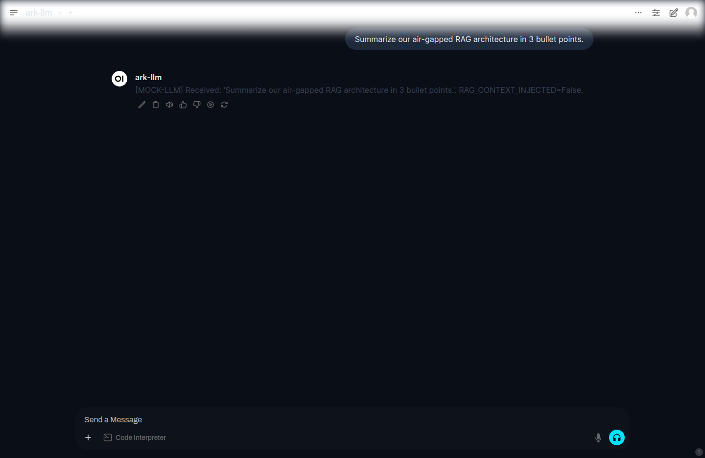
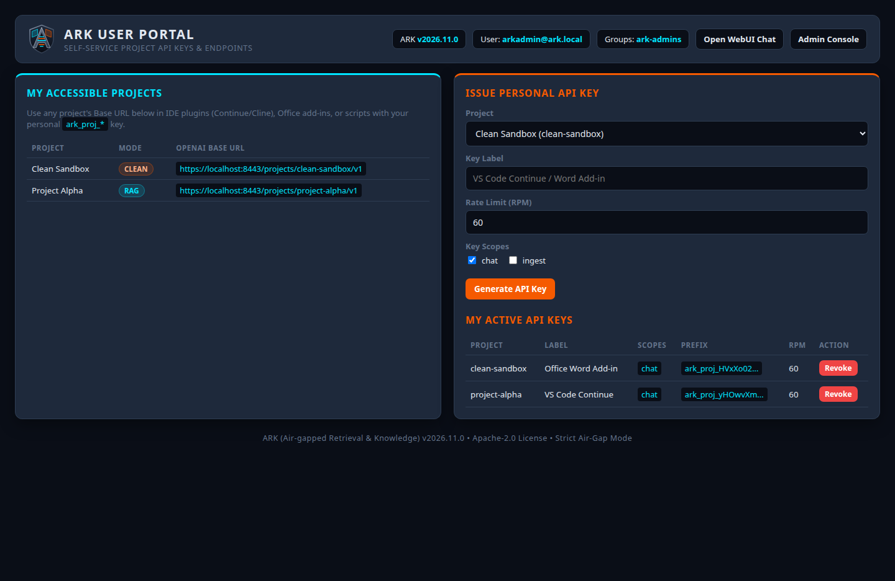
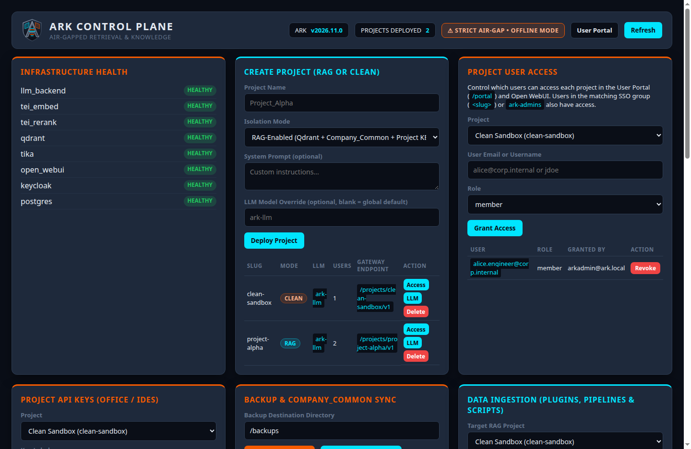
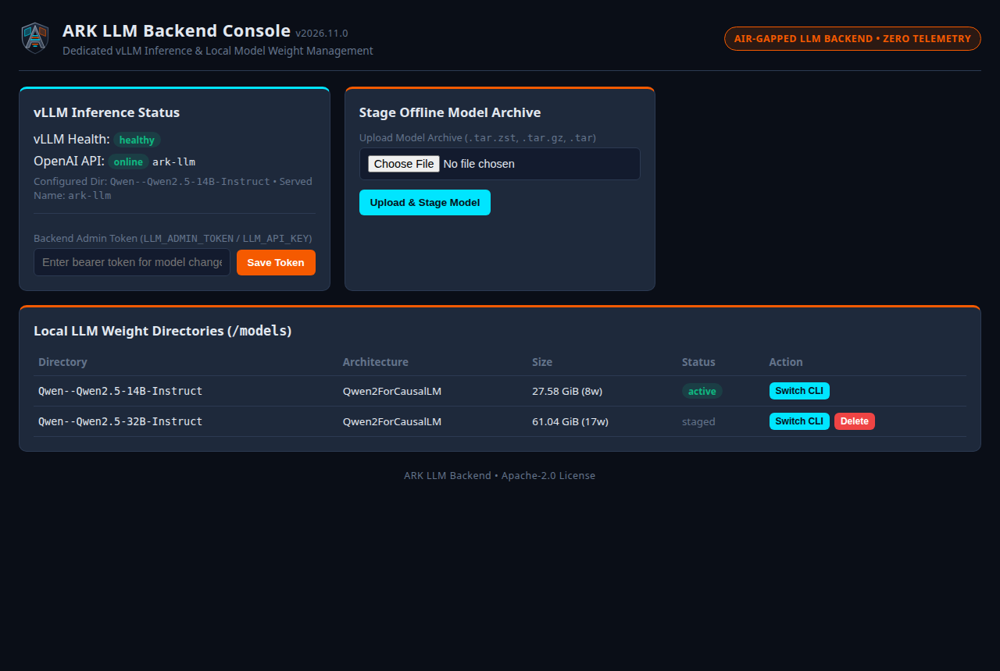

  

# ARK (Air-gapped Retrieval & Knowledge)

**Version:** `2026.11.0` · **License:** [Apache-2.0](LICENSE) · **Changelog:** [CHANGELOG.md](CHANGELOG.md) · **Security:** [SECURITY.md](SECURITY.md)

**ARK** is a 100% open-source, self-hosted AI assistant and knowledge platform built for **strictly air-gapped (offline)** organizations. It gives your teams private LLM chat, document-grounded search (RAG), corporate Single Sign-On, and project-scoped APIs for IDEs and Office tools—without a single byte ever leaving your network.

---

## Who Is ARK For?

- **Air-Gapped & Regulated Organizations:** Defense, government, critical infrastructure, finance, healthcare, and R&D teams that require modern AI capabilities with zero internet connectivity and zero external telemetry.
- **Project & Engineering Teams:** Teams working across sensitive or compartmentalized projects who need separate AI assistants, isolated document knowledge bases, and OpenAI-compatible API keys for IDEs (VS Code, Continue, Cline) and Office add-ins.
- **IT & Platform Administrators:** Infrastructure teams looking for a turnkey offline appliance with Active Directory / Enterprise SSO integration, role-based access control, document connectors, audit logging, and one-click backups.

---

## Key Capabilities

- **100% Offline by Design:** Runs completely inside your internal network with no external API calls, cloud dependencies, or telemetry.
- **Isolated Project Workspaces:** Create **RAG-enabled projects** (each with its own private document collection and assistant) or **Clean projects** (general-purpose AI chat with no document retrieval) so sensitive project data never mixes.
- **Enterprise Single Sign-On:** Users sign in with their existing corporate credentials (Active Directory, Kerberos, SAML 2.0, or OIDC), and project permissions follow their IT security groups automatically.
- **Built-in Document Ingestion:** Connect **SharePoint On-Prem**, **M-Files**, **SMB/NFS file shares**, or custom data pipelines to automatically index PDFs, Word, Excel, PowerPoint, and text files.
- **Scoped APIs for IDEs & Office Tools:** Issue project-specific API keys with per-minute rate limits and full audit trails so developers and analysts can use AI directly inside their editor or documents.
- **Flexible GPU Hosting:** Run the AI models on the same server, offload inference to a dedicated GPU server, or point ARK to an existing internal OpenAI-compatible endpoint.

---

## Product Tour

### 1. AI Chat Workspace (WebChat UI — `/`)
Team members sign in with Corporate SSO to chat with their authorized project assistants in **Open WebUI**, styled with the ARK dark theme and isolated per-project knowledge bases.

### 2. ARK User Portal (`/portal/`)
From the **ARK User Portal**, users can view the projects they have access to and create or revoke personal, scoped API keys (`chat` / `ingest`) for their IDE or Office add-ins.

### 3. ARK Control Plane (`/admin-console/`)
IT administrators use the **ARK Control Plane** to monitor system health, provision RAG or Clean projects, control per-user project access, issue and revoke scoped API keys, configure document connectors and ingestion pipelines, view audit logs, and run full backups.

### 4. ARK LLM Backend Console (`:8095`)
When running inference on a dedicated GPU host, infrastructure teams can use the standalone **ARK LLM Backend Console** to inspect live model status, stage offline model archives, and manage local model weights.

---

## How to Use ARK

### For End Users
1. **Sign In:** Open your organization's ARK URL (e.g., `https://ark.corp.internal`) and log in via **Corporate SSO**.
2. **Choose a Project Assistant:** In the chat model selector, pick the assistant for your project (e.g., a RAG assistant to search project documents with citations, or a Clean assistant for general drafting and coding).
3. **Upload Documents (if authorized):** Add project files in your project's Knowledge tab so only members of that project can query them.
4. **Connect Your IDE or Office Add-in:** Visit `/portal/`, generate a personal API key for your project, and paste the project's base URL and key into your tool.

For detailed instructions and API examples, see the **[User & Operations Guide](docs/USER_GUIDE.md)**.

### For Administrators
1. **Bundle at HQ:** On an internet-connected build machine, run `./scripts/bundle-offline.sh --package-models` to package container images and model weights for offline transfer.
2. **Install Offline:** Transfer the bundle to your air-gapped Linux GPU server, configure `.env`, and run `./scripts/install-offline.sh`.
3. **Provision & Operate:** Open `/admin-console/` to create projects, connect SharePoint/M-Files/SMB data sources, manage API keys, and schedule backups.

For the full deployment runbook, see the **[Installation & Setup Guide](docs/INSTALL.md)**.

---

## Documentation

| Document | Description |
| :--- | :--- |
| **[Installation & Setup Guide](docs/INSTALL.md)** | Offline bundling at HQ, server installation, SSO, TLS, and disaster recovery |
| **[User & Operations Guide](docs/USER_GUIDE.md)** | Day-to-day usage for end users, IDE/API integration, and admin operations |
| **[Architecture & Implementation](docs/ARCHITECTURE.md)** | System architecture diagram, security boundaries, repo structure, and GPU-less testing |
| **[Branding & Design System](docs/BRANDING.md)** | Logo assets and UI color palette |
| **[Contributing](CONTRIBUTING.md)** | Engineering rules, local dev workflow, and pull request checklist |
| **[Security Policy](SECURITY.md)** | Supported versions and vulnerability reporting |
