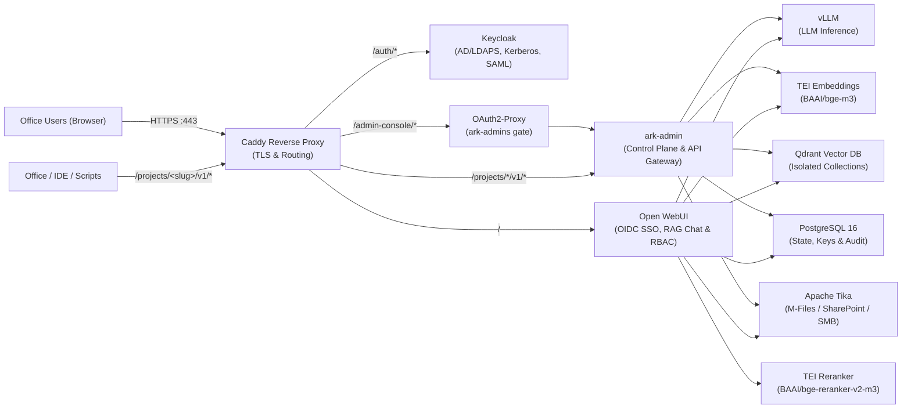

# ARK (Air-gapped Retrieval & Knowledge)

ARK (`ark-stack`) is a 100% open-source, Linux-based Infrastructure-as-Code (IaC) appliance for deploying high-concurrency local LLM inference, enterprise SSO, and multi-tenant RAG across **strictly air-gapped (offline)** offices.

- **[Installation & Setup Guide](docs/INSTALL.md)** — HQ bundling, offline server installation, Keycloak/AD SSO, TLS, and initial setup.
- **[User & Operations Guide](docs/USER_GUIDE.md)** — Day-to-day usage for end users (WebUI chat, Office/IDE APIs) and administrators (`ark-admin`, connectors, backups, and audits).

---

## 1. Project Overview & Architecture



### Core Capabilities
- **Strict Air-Gap Compliance:** Zero external network calls. `HF_HUB_OFFLINE=1`, `TRANSFORMERS_OFFLINE=1`, `DO_NOT_TRACK=1`, `OFFLINE_MODE=true`, `QDRANT__TELEMETRY_DISABLED=true`, and `VLLM_NO_USAGE_STATS=1` are enforced across the stack.
- **Unified Enterprise SSO:** **Keycloak** federates on-prem Active Directory (LDAPS), Kerberos, and SAML 2.0 into OIDC for both **Open WebUI** and **ark-admin** (via `oauth2-proxy`).
- **Multi-Tenant Data Compartmentalization:** Each project receives an isolated Qdrant collection, RBAC group, and locked Workspace Assistant—or can be created as a **clean (non-RAG) project**.
- **Scoped Per-Project API Gateway:** Office add-ins, IDE plugins, and scripts authenticate via `/projects/<slug>/v1/chat/completions` using project-scoped `ark_proj_*` keys with rate limits and audit logging. Unauthenticated raw `/v1/*` access is blocked at Caddy (`403`).
- **Document Connectors:** Built-in offline ingestion from **M-Files**, **SharePoint On-Prem**, and **SMB/NFS folders** via Apache Tika and TEI.
- **Local + SIEM Audit & Configurable Backups:** Every admin action and API call is logged to PostgreSQL (`ark_admin.audit_logs`), `./data/audit/audit.jsonl`, and optional Syslog SIEM. Backup paths are configurable at install time and in the Admin UI.

---

## 2. Repository Structure

```text
ark-stack/
├── README.md
├── .gitignore
├── .env.example
├── docker-compose.yml               # Production multi-container GPU stack
├── docker-compose.test.yml          # GPU-less test override (mock vLLM & TEI)
├── admin/                           # ark-admin Control Plane & Project API Gateway
│   ├── Dockerfile
│   ├── requirements.txt
│   ├── app.py
│   ├── audit.py
│   ├── connectors.py
│   └── static/index.html
├── config/
│   ├── caddy/Caddyfile              # Local HTTPS proxy, forward_auth, & API routing
│   ├── keycloak/ark-realm.json      # Declarative OIDC realm & clients
│   ├── postgres/init.sql            # Multi-DB init (openwebui, keycloak, ark_admin)
│   └── qdrant/config.yaml           # Production Qdrant config (telemetry disabled)
├── docs/
│   ├── INSTALL.md                   # HQ bundling & air-gapped installation runbook
│   └── USER_GUIDE.md                # End-user & administrator operations guide
├── provisioning/
│   ├── requirements.txt
│   ├── bootstrap_ark.py             # CLI project provisioner
│   └── sync_ad_groups.py            # Optional direct AD -> Open WebUI group sync
├── scripts/
│   ├── bundle-offline.sh            # HQ: pulls/builds images & downloads HF models
│   ├── install-offline.sh           # Office: verifies checksums, loads & starts ARK
│   ├── sync-company-kb.sh           # Imports Company_Common Qdrant snapshots
│   └── test-integration.sh          # Automated GPU-less integration test suite
└── tests/
    └── mock_inference.py            # Stdlib mock vLLM & TEI server for testing
```

---

## 3. Running for Testing (No GPU Required)

You can validate the full integration—PostgreSQL, Qdrant, Keycloak SSO, `oauth2-proxy`, `ark-admin`, Caddy routing, per-project APIs, backups, and audit logging—on any Linux workstation without an NVIDIA GPU or model weights.

### Option A: Automated Integration Test Suite (Works Without `docker compose`)
Run [scripts/test-integration.sh](scripts/test-integration.sh):
```bash
./scripts/test-integration.sh
```
This spins up an isolated `ark-test-net` environment using [tests/mock_inference.py](tests/mock_inference.py) and verifies:
1. Keycloak OIDC discovery through Caddy (`/auth/realms/ark/.well-known/openid-configuration`).
2. `oauth2-proxy` SSO redirect on `/admin-console/` (`HTTP 302`).
3. Raw `/v1/*` bypass block (`HTTP 403`).
4. Creation of both a RAG project (`Project_Alpha`) and a clean non-RAG project (`Clean_Sandbox`).
5. Per-project `/projects/<slug>/v1/chat/completions` routing, Qdrant RAG context injection, and cross-project API key rejection (`HTTP 403`).
6. Full `pg_dump` + Qdrant snapshot backup execution.
7. PostgreSQL audit log recording.

To leave the test containers running so you can inspect endpoints manually:
```bash
./scripts/test-integration.sh --keep
```

### Option B: Docker Compose Test Override
If `docker compose` is installed, you can start the stack with mock inference using [docker-compose.test.yml](docker-compose.test.yml):
```bash
cp .env.example .env
docker compose -f docker-compose.yml -f docker-compose.test.yml up -d
```
