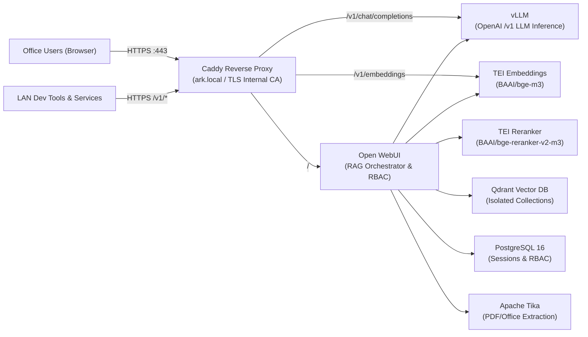

# ARK (Air-gapped Retrieval & Knowledge)

ARK (`ark-stack`) is a 100% open-source, Linux-based Infrastructure-as-Code (IaC) appliance for deploying high-concurrency local LLM inference and multi-tenant RAG across **strictly air-gapped (offline)** offices.

---

## 1. Architecture Overview



### Key Design Guarantees
- **Strict Air-Gap Compliance:** Zero external network calls. `HF_HUB_OFFLINE=1`, `TRANSFORMERS_OFFLINE=1`, `DO_NOT_TRACK=1`, `OFFLINE_MODE=true`, `QDRANT__TELEMETRY_DISABLED=true`, `ANONYMIZED_TELEMETRY=false`, and `VLLM_NO_USAGE_STATS=1` are enforced across containers.
- **Data Compartmentalization:** Each project (`Project_Alpha`, `Project_Beta`, etc.) receives an isolated Qdrant collection, a dedicated Open WebUI RBAC group (`project-alpha`), and a locked Workspace Assistant bound to `Company_Common` (read-only) + its own project collection.
- **High-Concurrency Production Stack:** Continuous batching and prefix caching in `vLLM`, GPU-accelerated `TEI` embeddings/reranking, `PostgreSQL 16` for concurrent session/RBAC state, and `Qdrant` with on-disk payloads.

---

## 2. Repository Structure

```text
ark-stack/
├── README.md
├── .gitignore
├── .env.example
├── docker-compose.yml
├── config/
│   ├── caddy/Caddyfile
│   ├── qdrant/config.yaml
│   └── postgres/init.sql
├── provisioning/
│   ├── requirements.txt
│   └── bootstrap_ark.py
└── scripts/
    ├── bundle-offline.sh
    ├── install-offline.sh
    └── sync-company-kb.sh
```

---

## 3. HQ Bundling Guide (Connected Environment)

Run this on a connected Linux workstation or build server with Docker, `zstd`, and `huggingface_hub[cli]` (`hf` or `huggingface-cli`) installed.

1. **Review image tags and model IDs:**
   ```bash
   cp .env.example .env
   # Edit .env if you want to pin different model IDs or image tags
   ```

2. **Pull Docker images, download Hugging Face models, and generate SHA-256 checksums:**
   ```bash
   ./scripts/bundle-offline.sh --package-models
   ```
   This produces:
   - `./artifacts/ark-images.tar.zst` (+ `.sha256`)
   - `./artifacts/models/<MODEL_DIR>`
   - `./artifacts/ark-models.tar.zst` (+ `.sha256`) when `--package-models` is passed

3. **Transfer to physical media** (encrypted drive / approved transfer diode) along with the `ark-stack` repository.

---

## 4. Offline Office Installation Runbook (Air-Gapped Linux GPU Server)

### Prerequisites
- Linux host with **NVIDIA GPU**, NVIDIA drivers, and `nvidia-container-toolkit`
- Docker Engine + Docker Compose v2 (`docker compose`)
- `zstd`, `curl`, `sha256sum`, and Python 3.10+ (for provisioning)
- Local DNS or `/etc/hosts` entry pointing `ark.local` (or your `ARK_DOMAIN`) to the server's LAN IP

### Deployment Steps
1. **Configure site secrets:**
   ```bash
   cp .env.example .env
   # Generate strong random values for VLLM_API_KEY, QDRANT_API_KEY, POSTGRES_PASSWORD, WEBUI_SECRET_KEY
   ```

2. **Verify checksums, load images, unpack models, and start ARK:**
   ```bash
   ./scripts/install-offline.sh
   ```
   The installer verifies `nvidia-smi`, checks free disk space, validates `.sha256` checksums, runs `docker load`, verifies local model directories in `./artifacts/models/`, creates `./data/*` volumes, and runs `docker compose up -d`.

3. **Verify all services are healthy:**
   ```bash
   docker compose ps
   ```

4. **Trust Caddy's Internal Root CA on LAN clients:**
   Caddy terminates HTTPS using `tls internal`. Export the generated root certificate after first startup and distribute it to office workstations:
   ```bash
   docker cp ark-caddy:/data/caddy/pki/authorities/local/root.crt ./ark-root-ca.crt
   ```

---

## 5. Multi-Tenant Project Provisioning

1. **Create the initial Open WebUI Admin account** at `https://ark.local` and generate an Admin API Key under **Settings → Account → API Keys**. Add it to `.env` as `OPENWEBUI_API_KEY`.

2. **Install Python dependencies** (from an offline wheelhouse or pre-installed environment):
   ```bash
   pip install -r provisioning/requirements.txt
   ```

3. **Provision an isolated project:**
   ```bash
   python3 provisioning/bootstrap_ark.py --create-project "Project_Alpha"
   ```
   *(Pass `--insecure` if the host OS has not yet imported `ark-root-ca.crt`.)*

   This idempotently creates:
   - Qdrant collections: `Company_Common` and `Project_Alpha`
   - Open WebUI RBAC group: `project-alpha`
   - Open WebUI Knowledge Bases: `Company_Common` (read-only) and `Project_Alpha` (restricted to `project-alpha`)
   - Workspace Assistant model: `Project Alpha Assistant` (`project-alpha-assistant`) bound to both Knowledge Bases and locked to `project-alpha`.

---

## 6. Syncing `Company_Common` Snapshots from HQ

To update the shared read-only `Company_Common` collection from a Qdrant snapshot exported at HQ:

```bash
./scripts/sync-company-kb.sh --snapshot /path/to/Company_Common.snapshot
```
If `Company_Common.snapshot.sha256` is alongside the snapshot, the script verifies integrity before uploading and recovering the collection via Qdrant's local API.

---

## 7. LAN OpenAI-Compatible API Endpoints

Internal developer tools and IDE extensions on the office LAN can call ARK directly through Caddy:

- **Chat Completions (`vLLM`):**
  ```bash
  curl https://ark.local/v1/chat/completions \
    -H "Authorization: Bearer ${VLLM_API_KEY}" \
    -H "Content-Type: application/json" \
    -d '{"model": "ark-llm", "messages": [{"role": "user", "content": "Hello"}]}'
  ```

- **Embeddings (`TEI BAAI/bge-m3`):**
  ```bash
  curl https://ark.local/v1/embeddings \
    -H "Content-Type: application/json" \
    -d '{"input": "Air-gapped retrieval test"}'
  ```

---

## 8. On-Prem Active Directory (LDAPS) Integration

1. **Place your AD Root CA certificate** at `./certs/ad-ca.crt` (mounted read-only to `/certs/ad-ca.crt` inside Open WebUI).
2. **Configure AD settings in `.env`:**
   - Set `ENABLE_LDAP=true`, `LDAP_SERVER_HOST`, `LDAP_SEARCH_BASE`, `LDAP_APP_DN`, and `LDAP_APP_PASSWORD`.
   - Keep `ENABLE_SIGNUP=false` so only domain accounts can sign in using `sAMAccountName`.
3. **Sync AD Security Groups to Open WebUI RBAC:**
   Create AD security groups prefixed with `ARK-` (e.g., `ARK-Project-Alpha`), then run or schedule:
   ```bash
   python3 provisioning/sync_ad_groups.py
   ```
   This resolves nested AD group memberships via LDAPS and updates the corresponding Open WebUI project groups (`project-alpha`).
