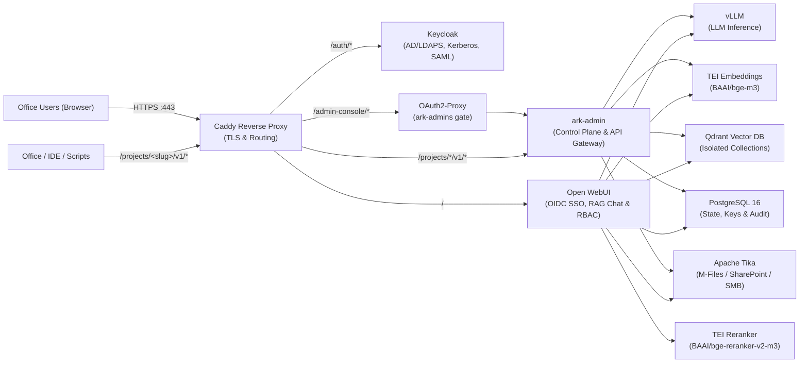

# ARK Architecture & Implementation Details

This document covers the internal architecture, security boundaries, repository layout, and GPU-less test environment for **ARK (`ark-stack`)**.

For product overview and usage, see the [README](../README.md). For deployment and operations, see the [Installation & Setup Guide](INSTALL.md) and [User & Operations Guide](USER_GUIDE.md).

---

## 1. System Architecture



### Technical Design & Invariants

- **Strict Air-Gap Compliance:** Zero external network calls. `HF_HUB_OFFLINE=1`, `TRANSFORMERS_OFFLINE=1`, `DO_NOT_TRACK=1`, `OFFLINE_MODE=true`, `QDRANT__TELEMETRY_DISABLED=true`, and `VLLM_NO_USAGE_STATS=1` are enforced across the stack, along with Caddy `ocsp_stapling off` and `tls internal`.
- **Unified Enterprise SSO:** **Keycloak** federates on-prem Active Directory (LDAPS), Kerberos, and SAML 2.0 into OIDC for both **Open WebUI** and **ark-admin** (via `oauth2-proxy` gated on `ark-admins` and `X-Ark-Proxy-Secret`).
- **Multi-Tenant Data Compartmentalization:** Each RAG-enabled project receives an isolated Qdrant collection, RBAC group, and locked Workspace Assistant—or can be created as a **clean (non-RAG) project**.
- **Scoped Per-Project API Gateway:** Office add-ins, IDE plugins, and scripts authenticate via `/projects/<slug>/v1/chat/completions` using project-scoped `ark_proj_*` keys (SHA-256 hashed in PostgreSQL) with rate limits and audit logging. Unauthenticated raw `/v1/*` access is blocked at Caddy (`403`).
- **Offline Document Ingestion:** Built-in connectors (`smb_folder`, `sharepoint`, `mfiles`, `http_json`), declarative `ark-ingest/v1` pipelines, and env-scrubbed custom Python scripts extract text via Apache Tika and index into Qdrant via TEI embeddings.
- **Local + SIEM Audit & Configurable Backups:** Every admin action and API call is logged to PostgreSQL (`ark_admin.audit_logs`), `./data/audit/audit.jsonl`, and optional Syslog SIEM. Backup bundles include compressed `pg_dump` archives, Qdrant snapshots, and a SHA-256 `manifest.json`.
- **Decoupled LLM Backend:** Run vLLM + its dedicated **ARK LLM Backend Console** (`ark-llm-admin`) on a separate GPU server ([`docker-compose.llm.yml`](../docker-compose.llm.yml)), locally via `docker compose --profile local-llm up -d`, or point ARK to any internal OpenAI-compatible API.

---

## 2. Repository Structure

```text
ark-stack/
├── VERSION                          # Canonical CalVer release version (YYYY.MM.PATCH)
├── LICENSE                          # Apache License 2.0
├── NOTICE                           # Attribution notice
├── CHANGELOG.md                     # Release history
├── SECURITY.md                      # Supported versions & vulnerability disclosure policy
├── CONTRIBUTING.md                  # Development workflow & air-gap engineering rules
├── CODE_OF_CONDUCT.md               # Contributor Covenant v2.1
├── README.md                        # Product overview & quickstart
├── .gitignore
├── .env.example
├── docker-compose.yml               # Production multi-container GPU stack (local-llm profile)
├── docker-compose.llm.yml           # Standalone dedicated GPU LLM + ark-llm-admin stack
├── docker-compose.test.yml          # GPU-less test override (mock vLLM & TEI)
├── admin/                           # ark-admin Control Plane & Project API Gateway
│   ├── Dockerfile
│   ├── requirements.txt
│   ├── app.py
│   ├── ark_ingest.py
│   ├── audit.py
│   ├── backup_utils.py
│   ├── builtin_plugins/             # Built-in connector plugins (http_json, mfiles, sharepoint, smb_folder)
│   ├── connectors.py
│   ├── ingest.py
│   ├── llm_backend.py
│   ├── pipelines.py
│   ├── plugins.py
│   ├── security.py
│   ├── version.py
│   └── static/
│       ├── index.html
│       ├── portal.html
│       └── ark-logo.svg
├── llm-admin/                       # Standalone ARK LLM Backend Console (port 8095)
│   ├── Dockerfile
│   ├── requirements.txt
│   ├── app.py
│   └── static/
├── config/
│   ├── caddy/Caddyfile              # Local HTTPS proxy, forward_auth, & API routing
│   ├── keycloak/ark-realm.json      # Declarative OIDC realm & clients
│   ├── open-webui/custom.css        # Air-gapped ARK branding theme for Open WebUI
│   ├── postgres/init.sql            # Multi-DB init (openwebui, keycloak, ark_admin)
│   └── qdrant/config.yaml           # Production Qdrant config (telemetry disabled)
├── docs/
│   ├── ARCHITECTURE.md              # System architecture, repo layout & test setup
│   ├── BRANDING.md                  # Visual identity & color palette
│   ├── INSTALL.md                   # HQ bundling & air-gapped installation runbook
│   ├── USER_GUIDE.md                # End-user & administrator operations guide
│   └── images/                      # Console screenshots
├── provisioning/
│   ├── requirements.txt
│   ├── bootstrap_ark.py             # CLI project provisioner
│   └── sync_ad_groups.py            # Optional direct AD -> Open WebUI group sync
├── scripts/
│   ├── bump-version.sh              # CalVer release bump helper
│   ├── bundle-offline.sh            # HQ: pulls/builds images & downloads HF models
│   ├── dev-up.sh                    # Local GPU-less interactive dev stack
│   ├── install-offline.sh           # Office: verifies checksums, loads & starts ARK
│   ├── restore-backup.sh            # Disaster-recovery verify & restore CLI
│   ├── sync-company-kb.sh           # Imports Company_Common Qdrant snapshots
│   ├── test-integration.sh          # Automated GPU-less integration test suite
│   └── update-llm.sh                # Atomic offline LLM/embed/rerank updater
└── tests/
    ├── mock_inference.py            # Stdlib mock vLLM & TEI server for testing
    └── test_admin_unit.py           # Unit tests (security, backups, version, UI XSS)
```

---

## 3. Running for Testing (No GPU Required)

You can validate the full integration—PostgreSQL, Qdrant, Keycloak SSO, `oauth2-proxy`, `ark-admin`, Caddy routing, per-project APIs, backups, and audit logging—on any Linux workstation without an NVIDIA GPU or model weights.

### Option A: Automated Integration Test Suite (Works Without `docker compose`)

Run [`scripts/test-integration.sh`](../scripts/test-integration.sh):

```bash
./scripts/test-integration.sh
```

This spins up an isolated `ark-test-net` environment using [`tests/mock_inference.py`](../tests/mock_inference.py) and verifies:
1. Keycloak OIDC discovery through Caddy (`/auth/realms/ark/.well-known/openid-configuration`).
2. `oauth2-proxy` SSO redirect on `/admin-console/` (`HTTP 302`).
3. Raw `/v1/*` bypass block (`HTTP 403`).
4. Creation of both a RAG project (`Project_Alpha`) and a clean non-RAG project (`Clean_Sandbox`).
5. Per-project `/projects/<slug>/v1/chat/completions` routing, Qdrant RAG context injection, and cross-project API key rejection (`HTTP 403`).
6. Full `pg_dump` + Qdrant snapshot backup execution.
7. PostgreSQL audit log recording.

To leave the test containers running so you can inspect endpoints manually:

```bash
./scripts/test-integration.sh --keep
```

### Option B: Docker Compose Test Override

If `docker compose` is installed, you can start the stack with mock inference using [`docker-compose.test.yml`](../docker-compose.test.yml):

```bash
cp .env.example .env
docker compose -f docker-compose.yml -f docker-compose.test.yml up -d
```

### Option C: Unit Tests & Local Dev Environment

```bash
# Shell syntax & Python unit tests
bash -n scripts/*.sh
python3 -m unittest discover -s tests -v

# Interactive local dev environment at https://localhost:8443
./scripts/dev-up.sh
./scripts/dev-up.sh --down
```

---

## 4. Versioning & Release Process

ARK follows **CalVer (`YYYY.MM.PATCH`)** with [`VERSION`](../VERSION) as the single source of truth. Run `./scripts/bump-version.sh YYYY.MM.PATCH` to update all build defaults consistently, and see [`CHANGELOG.md`](../CHANGELOG.md) for release notes.
